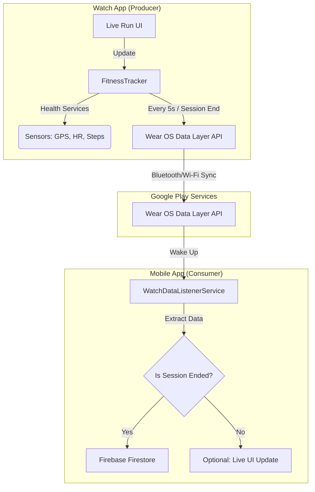

# UniMove Data Flow: Watch to Mobile to Database

This document explains the end-to-end journey of a running session's data.

## 1. High-Level Architecture
The system uses a **Producer-Consumer** model via the **Google Play Services Data Layer**.

---

## 2. Step-by-Step Flow

### Step A: Data Collection (The Watch)
1.  **User Action:** User taps "Run" on the `RunStartScreen`.
2.  **Service Start:** `MainActivity` starts `TrackingForegroundService` to keep the app alive.
3.  **Sensor Binding:** `FitnessTracker` connects to **Android Health Services**. It requests:
    *   `DataType.DISTANCE_TOTAL` (via GPS/Accelerometer)
    *   `DataType.HEART_RATE_BPM` (via PPG sensor)
    *   `DataType.STEPS_TOTAL` (via Pedometer)
4.  **Local State:** The UI updates in real-time as `FitnessTracker` emits a `TrackingUiState`.

### Step B: The "Bridge" (Wear OS Data Layer)
1.  **Background Sync:** Every 5 seconds, `FitnessTracker` calls `maybeSendUpdate()`.
2.  **Payload:** It creates a `PutDataMapRequest` containing a "bundle" of the current stats.
3.  **The Path:** Data is sent on two specific paths:
    *   `/unimove/live_run`: For real-time updates.
    *   `/unimove/run_session`: Only sent at the end (the "Final Summary").
4.  **Reliability:** This is the most important part. If the phone is disconnected, the **Data Layer API** buffers these requests. The moment the watch and phone are back in range, the phone's system "pushes" all missed updates to the mobile app.

### Step C: Reception (The Mobile App)
1.  **Activation:** The phone's OS detects incoming data on the `/unimove` path. It looks into the `AndroidManifest` and sees that `WatchDataListenerService` is registered to handle it.
2.  **Service Wakeup:** The OS starts the `WatchDataListenerService` in the background (even if the app is closed).
3.  **Processing:** The `onDataChanged` method triggers. It pulls the `distance`, `steps`, and `heartRate` out of the `DataMap`.

### Step D: Final Storage (Firebase)
1.  **Conditional Trigger:** The service checks if `isEnded == true`.
2.  **Authentication:** It retrieves the current user's ID using `Firebase.auth.currentUser`.
3.  **Write Operation:** It creates a document in Firestore at:
    `users/{userId}/sessions/{sessionId}`
4.  **Sync Complete:** The session is now safely stored in the cloud and can be viewed on the phone app or any other device.

---

## 3. Technology Stack Used
| Component | Technology | Purpose |
| :--- | :--- | :--- |
| **Watch UI** | Jetpack Compose for Wear OS | Modern, circular-optimized interface. |
| **Watch Sensors** | Android Health Services | Power-efficient access to HR, Steps, and GPS. |
| **Communication** | Wear OS Data Layer API | Reliable, offline-capable sync between devices. |
| **Mobile Receiver** | WearableListenerService | Background processing of watch data. |
| **Cloud Storage** | Firebase Firestore | NoSQL database for syncing user sessions. |
| **Authentication** | Firebase Auth | Linking watch data to the correct user account. |
